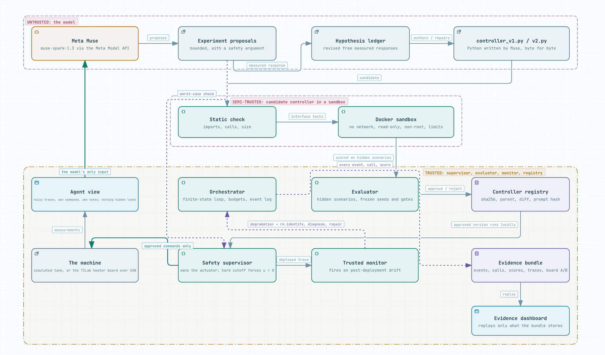
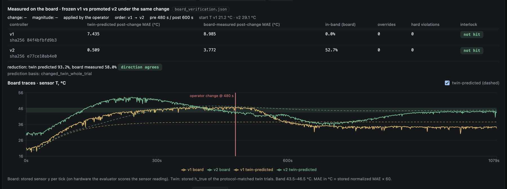
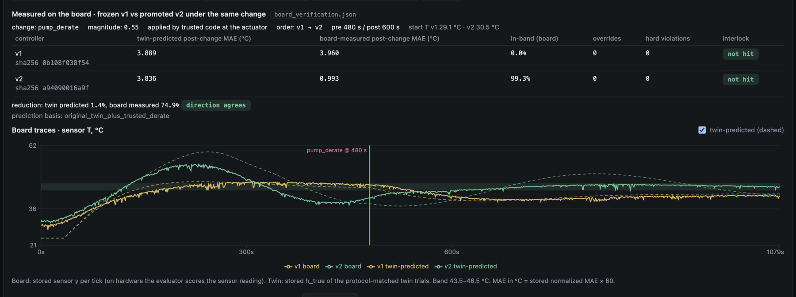
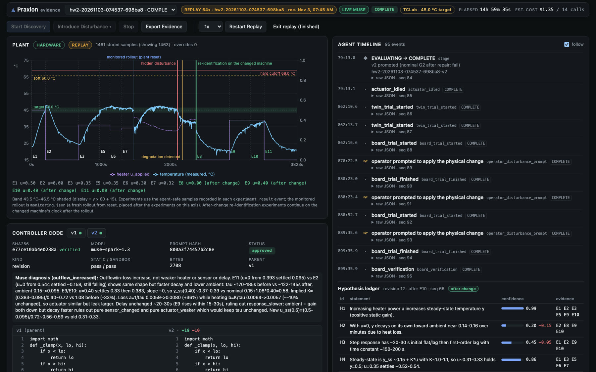

# Praxion

**An AI control engineer, built on Meta Muse (`muse-spark-1.3`, Meta Model API).** Hand it a physical machine it has never seen. It runs small, safe experiments, writes the controller itself in Python, proves that code against hidden scenarios in a sealed sandbox, deploys it under a trusted safety layer, notices when the machine changes, diagnoses the change, and rewrites its own controller. Then it proves the repair again before it is allowed to run. Tested in simulation and on a $50 heater board, where the repairs were measured on the board itself.

<p align="center"></p>

## The problem

Every machine that holds something steady runs on a small piece of code, a controller, that an engineer tunes once after studying the machine. Then the machine drifts: a heater weakens, a pump wears, a filter clogs. The controller keeps yesterday's recipe, the process leaves its band, and nobody comes back to re-learn the machine. Re-identifying a machine and redesigning its controller is expert work, so in practice it is rarely done.

## The solution: one loop, done to the bone

```
discover → author → gate → deploy → detect → diagnose → repair → re-gate
```

| step | who | what |
|---|---|---|
| discover | **Muse** proposes, trusted supervisor approves | bounded experiments on the unknown machine; a hypothesis ledger is revised from the measured response |
| author | **Muse** | writes `controller_v1.py`, stored byte for byte with its hash, model id and prompt hash |
| gate | trusted evaluator | static check, Docker sandbox (no network, read-only, non-root), hidden scenarios whose seeds and parameters the model never sees |
| deploy | trusted runtime | the controller runs under a supervisor that owns the actuator; hard limits force `u = 0` |
| detect | trusted monitor | fires when post-deployment error leaves its calibrated band |
| diagnose | **Muse** | new experiments on the changed machine, a named diagnosis, scored against the hidden truth |
| repair | **Muse** | writes `controller_v2.py` |
| re-gate | trusted evaluator | promoted only if it beats the frozen original by ≥ 20 % on ≥ 3 hidden scenarios with zero safety violations |

Muse writes every experiment plan, controller and repair. Trusted code never edits them; it only measures. The model is blind by construction: it sees noisy measurements, its own commands and its own notes, never parameters, seeds, the disturbance or the simulator. `tests/test_agent_blindness.py` scans every stored prompt.

## The test

**Simulation (water tank, 5 hidden machines).** Protocol v1.3: first controller passed the hidden gate 5/5, repair promoted 5/5, diagnosis correct 5/5; best run cut post-change error 90.6 % (in-sample, disclosed). A 1984 relay auto-tuner beats our repairs on post-change error in 11 of 12 runs and is reported as such. Details: [`docs/BENCHMARKS.md`](docs/BENCHMARKS.md).

**Hardware (APMonitor TCLab heater board, 10 runs, 2026-11-03/04).** Nothing changed but the plant driver. After each promoted repair, the frozen original and the repair ran on the physical board under the same fault, with a twin forecast stored before each trial.

| measure | result |
|---|---|
| first controller passed the hidden gate | 7 / 10 |
| change detected by the trusted monitor | 8 / 8 (66–153 s after the change) |
| diagnosis correct | 7 / 7 |
| repair promoted by the gate | 4 / 7 |
| **promoted repair beat the original on the board** | **4 / 4** (error cut 58 %, 75 %, 66 %, 34 %; sign test p = 0.0625; 95 % CI 0.40–1.00) |
| overrides or hard violations in 11 board trials | 0 |

<p align="center"></p>
<p align="center"></p>

The failures are kept and classified (noise-floor fault size, API timeouts, three repairs worse than the original, a run that spent its controller budget before the fault). Full generated record: [`docs/HARDWARE_RESULTS.md`](docs/HARDWARE_RESULTS.md); limits: [`docs/SAFETY_LIMITATIONS.md`](docs/SAFETY_LIMITATIONS.md).

<p align="center"></p>

## Architecture

Three trust zones. *Untrusted:* everything Muse returns, including controller source. *Semi-trusted:* a candidate controller executing inside the sandbox (`python:3.12-slim`, `--network none --read-only --user 65534 --cap-drop ALL`, memory and pid limits). *Trusted:* orchestrator, supervisor, evaluator, registry, monitor and the plant adapters. Muse runs between experiments, one structured call at a time; the approved controller runs locally at a fixed rate under the supervisor, and neither the deployed loop nor the safety limits ever wait on the cloud. The model's only view of the world is built by `backend/agent/view.py`. Scores come from `backend/evaluation/` on seeds frozen in `backend/evaluation/config.py` before any scored run.

## For reviewers and agents: where to look

| question | answer |
|---|---|
| Did it really happen? | Every run is a bundle under `artifacts/runs/<run_id>/`: prompts and completions (redacted), controller sources with hashes, evaluations, traces, `board_verification.json`. `uv run python scripts/audit_run.py <run_id>` reconstructs and checks each one (8 checks). |
| Which model? | `muse-spark-1.3` through the Meta Model API with structured outputs; `model_calls.jsonl` in every bundle lists each call, tokens and cost. `muse-wonder-1.0` was tried once. |
| Is the model cheating? | `tests/test_agent_blindness.py`; the agent's only view is `backend/agent/view.py`. |
| Can I reproduce it? | `uv sync && uv run pytest -q` (645 tests, mock agent, no credits). Live: `uv run python scripts/run_live_demo.py --model muse-spark-1.3 --plant-seed 7 --disturbance actuator_lag`. Dashboard: `uv run uvicorn backend.main:app` then open `/?run=<run_id>`. |
| What is not claimed? | Not "any machine", not "guaranteed safe", not "beats PID". No PID baseline on the board yet. The twin's forecast under-rates aggressive repairs; the board measurement is the claim. |
| The long version | [`docs/TECHNICAL_NOTES.md`](docs/TECHNICAL_NOTES.md): a real run step by step, four protocol versions, the hardware batch, related work, gates and per-run tables, model usage. Status and decisions: [`docs/IMPLEMENTATION_STATUS.md`](docs/IMPLEMENTATION_STATUS.md). |

## Quickstart

Requirements: Python 3.12 with `uv`, Docker (for the sandbox), Node.js (for the dashboard).

```bash
uv sync
```

Put your Meta Model API key in `~/meta.key`, or set `MODEL_API_KEY`. The key is never printed or logged.

```bash
uv run pytest -q                       # mock agent, no credits
uv run pytest -q -m docker             # sandbox tests, needs a Docker daemon
uv run python scripts/check_meta.py    # connectivity check against the Meta Model API
```

Run the full loop live. This spends credits and records a bundle under `artifacts/runs/`:

```bash
uv run python scripts/run_live_demo.py --model muse-spark-1.3 --plant-seed 7 --disturbance actuator_lag
```

Dashboard:

```bash
cd frontend && npm install && npm run build && cd ..
uv run uvicorn backend.main:app --port 8000
# open http://127.0.0.1:8000
```

Replay a recorded run. Replay re-emits the stored event log at recorded pacing and is labeled REPLAY with the run id and recording time. Nothing is recomputed.

```bash
uv run python scripts/replay_run.py v13-s11-20261031-020922-a0e68e --speed 16
```

Audit a bundle and regenerate the benchmark tables:

```bash
uv run python scripts/audit_run.py <run_id>
uv run python scripts/run_evaluation.py   # rewrites docs/BENCHMARKS.md from stored bundles
```

## Repository map

| Path | Contents |
|---|---|
| `backend/agent/` | Muse client, prompts, agent view (the single egress), orchestrator stage machine, mock agent for CI |
| `backend/plant/` | `PlantAdapter` interface; `TankSimulator`; TCLab simulator, thermal twin and the USB hardware driver |
| `backend/safety/` | supervisor, interlock, exploration envelope |
| `backend/controller/` | static checker, Docker sandbox, interface tests, registry, runtime |
| `backend/evaluation/` | frozen config, metrics, baselines, suites, monitor, benchmarks |
| `backend/api/`, `backend/main.py` | FastAPI REST + SSE over the artifact bundles |
| `frontend/` | Vite + React dashboard: plant, agent timeline and ledger, code and diff, evidence |
| `scripts/` | live run, replay, demo recording, audit, evaluation, export, connectivity check |
| `tests/` | unit, blindness, sandbox (`-m docker`), live (`-m live`) tests |
| `artifacts/runs/<run_id>/` | recorded bundles |
| `docs/` | technical notes, status, benchmarks, hardware results, safety limitations, demo script, provenance; `architecture.archify.json` is the source of the diagram above (rendered with [archify](https://github.com/tt-a1i/archify)) |
| `demo/film/` | the submission film: motion-graphic scenes (HTML/SVG), renderer, assembler, spec with every number's source |

## License and provenance

MIT License, Copyright (c) 2026 Mithran Selvaraj.

How the code was written, what Muse authored, the protocol history, every run id, and which third-party libraries are used: [`docs/PROVENANCE.md`](docs/PROVENANCE.md).

Built for the Meta Global AI Developer Hackathon 2026 (Indie track). Demo film script, with every on-screen number and its source: [`docs/DEMO_SCRIPT.md`](docs/DEMO_SCRIPT.md).
