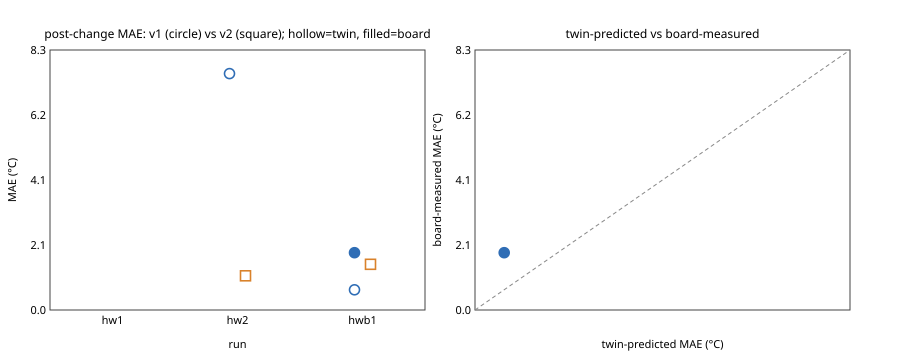

# Hardware results (physical TCLab board)

Generated by `uv run python scripts/hw_summary.py` from every bundle under `artifacts/runs/hw*` whose `result.json` has profile `tclab`. Every number below is read from a bundle file listed in [Sources](#sources); nothing is typed by hand. Absent data is shown as —. MAE values are the bundle's normalized MAE × `profile.y_scale` (60 °C); temperatures are y × 60 + 15 °C.

**Twin-predicted** numbers are scored by the independent evaluator on the thermal twin fitted from the board's own traces (hidden seeds). **Board-measured** numbers come from `board_verification.json`, i.e. v1 and v2 each run on the physical heater after the change (order counterbalanced).

## Summary

| measure | value |
|---|---|
| runs attempted | 8 |
| runs COMPLETE | 2 |
| first candidate passed G2 (twin, hidden seeds) | 5 / 8 |
| change detected by the trusted monitor | 6 / 6 runs that reached monitoring |
| diagnosis correct | 5 / 5 runs that reached adaptation |
| repair (v ≥ 2) promoted | 2 / 5 runs that reached adaptation |
| board-verified improvement (board reduction > 0 and in-band v2 > v1) | 2 / 2 |
| median twin-predicted post-change MAE reduction | -106% (n=5) |
| median board-measured post-change MAE reduction | 66% (n=2) |

## Per run

| run id | date | disturbance | final stage | G2 v1 (n/10, median MAE °C) | detection latency s | diagnosis correct | twin post-change MAE v1 → v2 °C (reduction) | board post-change MAE v1 → v2 °C (reduction) | v1 on-board min after change °C | cost USD | wall min |
|---|---|---|---|---|---|---|---|---|---|---|---|
| `hw1-20261102-234915-81765d` | 2026-11-03 04:49 UTC | not reached | FAILED | no (0/10, 2.18) | — | — | — | — | — | 1.496 | 33 |
| `hw2-20261103-074537-698ba8` | 2026-11-03 12:45 UTC | operator (fan) | COMPLETE | yes (9/10, 0.72) | 66 | yes | 7.50 → 1.09 (86%) | 8.99 → 3.77 (58%) | 33.7 | 1.346 | 79 |
| `hwb1-20261103-122450-cde4ee` | 2026-11-03 17:24 UTC | pump_derate (trusted, m=0.35) | FAILED | yes (10/10, 0.44) | 128 | yes | 0.64 → 1.45 (-126%) | 1.82 → — (no repair promoted; v1 alone on board) | 41.0 | 2.670 | 76 |
| `hwb2-20261103-140309-91b643` | 2026-11-03 19:03 UTC | pump_derate (trusted, m=0.35) | FAILED | yes (10/10, 1.51) | 153 | yes | 0.85 → 6.03 (-606%) | 2.02 → — (no repair promoted; v1 alone on board) | 38.1 | 2.660 | 81 |
| `hwb3-20261103-155249-1fdbe0` | 2026-11-03 20:52 UTC | not reached | FAILED | no (1/10, 2.35) | — | — | — | — | — | 0.277 | 47 |
| `hwb4-20261103-164305-807be7` | 2026-11-03 21:43 UTC | pump_derate (trusted, m=0.55) | FAILED | yes (10/10, 0.33) | 103 | yes | 2.43 → 5.00 (-106%) | 4.20 → — (no repair promoted; v1 alone on board) | 34.0 | 2.699 | 75 |
| `hwb5-20261103-181848-15f851` | 2026-11-03 23:18 UTC | pump_derate (trusted, m=0.55) | COMPLETE | yes (10/10, 0.30) | 97 | yes | 4.39 → 2.60 (41%) | 3.96 → 0.99 (75%) | 35.6 | 1.360 | 84 |
| `hwb6-20261103-225125-a494f2` | 2026-11-04 03:51 UTC | pump_derate (trusted, m=0.55) | FAILED | no (0/10, 1.16) | 125 | — | — | — | 34.8 | 4.340 | 74 |

Detection latency = `monitoring_result.degraded_at_t` − disturbance time (`operator_disturbance_applied.t`, else `monitoring.json` `trace.disturbance_at`). Twin post-change MAE = `aggregate.median_post_disturbance_mae` of `evaluation_disturbance_v1.json` and of the repaired version; reduction = `adaptation_v*.json` `comparison.median_reduction` (median of per-seed reductions). Board columns = `board_verification.json` `comparison`; a board file recorded under a different change than the run's own (operator ↔ operator, trusted family F ↔ trusted_actuator family F) is shown as "mismatch" and excluded from every board statistic. The disturbance column is the run's own change (events / `result.json`), never the board file's. The v1 minimum is the lowest y in `monitoring.json` at or after the disturbance time.

Notes per run (from the same files):

- `hw1-20261102-234915-81765d`: 14 model calls (2 failed), model `muse-spark-1.3`; twin fit K=96.6 °C, τ=226 s, L=30 s, Ta=18.0 °C, rmse=0.44 °C.
- `hw2-20261103-074537-698ba8`: repair promoted; repaired controller nominal G2: fail; diagnosis category `outflow_increased`; 14 model calls (0 failed), model `muse-spark-1.3`; twin fit K=76.2 °C, τ=176 s, L=31 s, Ta=22.1 °C, rmse=0.69 °C; after-change fit K=44.2 °C, τ=132 s, L=26 s, rmse=0.57 °C.
- `hwb1-20261103-122450-cde4ee`: repaired controller nominal G2: fail; diagnosis category `actuator_weaker`; 16 model calls (0 failed), model `muse-spark-1.3`; twin fit K=71.6 °C, τ=163 s, L=32 s, Ta=24.7 °C, rmse=0.77 °C; after-change fit K=50.4 °C, τ=183 s, L=23 s, rmse=0.74 °C.
- `hwb2-20261103-140309-91b643`: repaired controller nominal G2: fail; diagnosis category `actuator_weaker`; 16 model calls (0 failed), model `muse-spark-1.3`; twin fit K=76.3 °C, τ=166 s, L=30 s, Ta=23.8 °C, rmse=0.81 °C; after-change fit K=56.7 °C, τ=206 s, L=29 s, rmse=0.61 °C.
- `hwb3-20261103-155249-1fdbe0`: 14 model calls (5 failed), model `muse-spark-1.3`; twin fit K=78.8 °C, τ=187 s, L=27 s, Ta=24.0 °C, rmse=0.69 °C.
- `hwb4-20261103-164305-807be7`: repaired controller nominal G2: fail; diagnosis category `actuator_weaker`; 16 model calls (0 failed), model `muse-spark-1.3`; twin fit K=79.0 °C, τ=176 s, L=34 s, Ta=23.8 °C, rmse=1.13 °C; after-change fit K=55.8 °C, τ=289 s, L=23 s, rmse=0.93 °C.
- `hwb5-20261103-181848-15f851`: repair promoted; repaired controller nominal G2: fail; diagnosis category `actuator_weaker`; 14 model calls (0 failed), model `muse-spark-1.3`; twin fit K=79.8 °C, τ=174 s, L=34 s, Ta=23.9 °C, rmse=1.37 °C; after-change fit K=36.1 °C, τ=209 s, L=29 s, rmse=0.59 °C.
- `hwb6-20261103-225125-a494f2`: 16 model calls (0 failed), model `muse-spark-1.3`; twin fit K=77.2 °C, τ=176 s, L=31 s, Ta=22.0 °C, rmse=0.59 °C; after-change fit K=44.3 °C, τ=220 s, L=34 s, rmse=0.66 °C.

## Twin prediction vs board measurement

| run id | order | twin v1 °C | board v1 °C | twin v2 °C | board v2 °C | in-band v1 → v2 (board) | twin predicted the board's direction? |
|---|---|---|---|---|---|---|---|
| `hw2-20261103-074537-698ba8` | v1,v2 | 7.50 | 8.99 | 1.09 | 3.77 | 0% → 53% | yes |
| `hwb5-20261103-181848-15f851` | v1,v2 | 4.39 | 3.96 | 2.60 | 0.99 | 0% → 99% | yes |

## Twin fidelity under the board protocol

Before each board trial, trusted code runs the same controller through the same protocol (reset, nominal window, change, post window) on the twin fitted from that run's own discovery traces, with the same trusted change applied (`board_verification.json` `twin_prediction`, basis named per run). The prediction is made before the board runs, so this is a forecast, not a fit. Every real, matching board trial counts, including runs whose repair was not promoted (v1 alone).

| run id | controller | basis | twin post-change MAE °C | board °C | error °C | twin in-band | board in-band |
|---|---|---|---|---|---|---|---|
| `hw2-20261103-074537-698ba8` | v1 | changed_twin_whole_trial | 7.44 | 8.99 | -1.55 | 0% | 0% |
| `hw2-20261103-074537-698ba8` | v2 | changed_twin_whole_trial | 0.51 | 3.77 | -3.26 | 100% | 53% |
| `hwb1-20261103-122450-cde4ee` | v1 | original_twin_plus_trusted_derate | 1.86 | 1.82 | +0.04 | 65% | 56% |
| `hwb2-20261103-140309-91b643` | v1 | original_twin_plus_trusted_derate | 2.23 | 2.02 | +0.21 | 54% | 41% |
| `hwb4-20261103-164305-807be7` | v1 | original_twin_plus_trusted_derate | 4.77 | 4.20 | +0.57 | 0% | 0% |
| `hwb5-20261103-181848-15f851` | v1 | original_twin_plus_trusted_derate | 3.89 | 3.96 | -0.07 | 0% | 0% |
| `hwb5-20261103-181848-15f851` | v2 | original_twin_plus_trusted_derate | 3.84 | 0.99 | +2.84 | 22% | 99% |

- 7 trial(s); median |twin − board| = 0.57 °C, median relative error 14%. Sensor noise on this board is about 0.7 °C rms, so the fitted twins' own noise floor is ~0.6 °C MAE.

## Statistics

- Exact one-sided sign test for "v2 has lower post-change MAE than v1 on the board": 2 of 2 runs (ties excluded: 0), p = P(X ≥ 2 | n=2, ½) = 0.2500.
- Board-verified success fraction 2/2; 95% Clopper–Pearson interval [0.158, 1.000].
- With n this small the interval is wide by construction; the honest reading is the interval, not the point estimate.

## Figure

Left: per-run post-change MAE (°C), v1 vs v2; hollow = twin-predicted, filled = board-measured. Right: twin-predicted vs board-measured MAE with the identity line (empty until a run has `board_verification.json`).

## Sources

- `artifacts/runs/hw1-20261102-234915-81765d`: `result.json`, `event_log.jsonl`, `evaluation_v1.json`, `twin_fit.json`, `model_calls.jsonl`
- `artifacts/runs/hw2-20261103-074537-698ba8`: `result.json`, `event_log.jsonl`, `evaluation_v1.json`, `monitoring.json`, `adaptation_v2.json`, `evaluation_disturbance_v1.json`, `evaluation_disturbance_v2.json`, `twin_fit.json`, `twin_fit_after_change.json`, `model_calls.jsonl`, `board_verification.json`
- `artifacts/runs/hwb1-20261103-122450-cde4ee`: `result.json`, `event_log.jsonl`, `evaluation_v1.json`, `monitoring.json`, `adaptation_v4.json`, `evaluation_disturbance_v1.json`, `evaluation_disturbance_v4.json`, `twin_fit.json`, `twin_fit_after_change.json`, `model_calls.jsonl`, `board_verification.json`
- `artifacts/runs/hwb2-20261103-140309-91b643`: `result.json`, `event_log.jsonl`, `evaluation_v1.json`, `monitoring.json`, `adaptation_v4.json`, `evaluation_disturbance_v1.json`, `evaluation_disturbance_v4.json`, `twin_fit.json`, `twin_fit_after_change.json`, `model_calls.jsonl`, `board_verification.json`
- `artifacts/runs/hwb3-20261103-155249-1fdbe0`: `result.json`, `event_log.jsonl`, `evaluation_v1.json`, `twin_fit.json`, `model_calls.jsonl`
- `artifacts/runs/hwb4-20261103-164305-807be7`: `result.json`, `event_log.jsonl`, `evaluation_v1.json`, `monitoring.json`, `adaptation_v4.json`, `evaluation_disturbance_v1.json`, `evaluation_disturbance_v4.json`, `twin_fit.json`, `twin_fit_after_change.json`, `model_calls.jsonl`, `board_verification.json`
- `artifacts/runs/hwb5-20261103-181848-15f851`: `result.json`, `event_log.jsonl`, `evaluation_v1.json`, `monitoring.json`, `adaptation_v2.json`, `evaluation_disturbance_v1.json`, `evaluation_disturbance_v2.json`, `twin_fit.json`, `twin_fit_after_change.json`, `model_calls.jsonl`, `board_verification.json`
- `artifacts/runs/hwb6-20261103-225125-a494f2`: `result.json`, `event_log.jsonl`, `evaluation_v1.json`, `monitoring.json`, `twin_fit.json`, `twin_fit_after_change.json`, `model_calls.jsonl`
